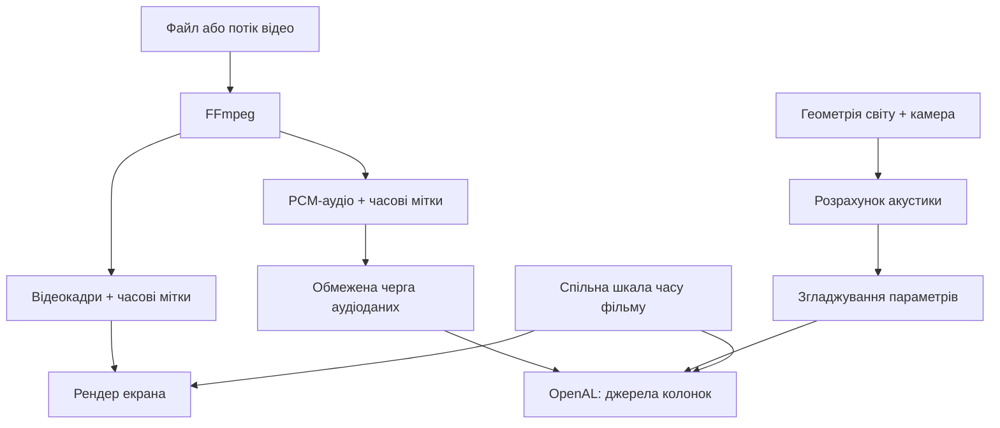

# ТЗ: акустика кінотеатру (Forge 1.20.1 + FFmpeg)

> Збережено як отримано (технічний звіт, який передається AI як основа реалізації). Висновки по нашому коду та
> перевірка тверджень звіту: [ACOUSTICS.md](ACOUSTICS.md).

Для **Forge 1.20.1 + FFmpeg** пропонується така реалізація: **FFmpeg декодує звук фільму в PCM, мод відтворює його через
просторові джерела OpenAL, а окремий акустичний модуль обчислює вплив блоків і приміщення.**

**Поведінка Sound Physics Remastered підтверджена його кодом. Архітектура кінотеатру й запропоновані параметри це
рекомендації для мода; їх потрібно перевірити в грі.**

## 1. Зафіксувати джерело, з якого відтворюється акустика

Використовувати код Sound Physics Remastered (SPR) для Minecraft **1.20.1**, коміт:

```text
d3904addf5a2279bbe3470f36e1f3814a647d526
```

[Зафіксований стан репозиторію](https://github.com/henkelmax/sound-physics-remastered/tree/d3904addf5a2279bbe3470f36e1f3814a647d526).
У цьому стані зазначені Java 17 і версія мода `1.20.1-1.5.1`. Поточну `master` не використовувати як джерело сигнатур
Minecraft 1.20.1.

| Джерело | Що в ньому дослідити |
|---|---|
| [SoundPhysics.java](https://github.com/henkelmax/sound-physics-remastered/blob/d3904addf5a2279bbe3470f36e1f3814a647d526/common/src/main/java/com/sonicether/soundphysics/SoundPhysics.java) | Центральний алгоритм, `calculateOcclusion`, `runOcclusion`, `evaluateEnvironment`, `setEnvironment` |
| [RaycastUtils.java](https://github.com/henkelmax/sound-physics-remastered/blob/d3904addf5a2279bbe3470f36e1f3814a647d526/common/src/main/java/com/sonicether/soundphysics/utils/RaycastUtils.java) | Перетин променів із геометрією блоків і рідин |
| [ReflectedAudio.java](https://github.com/henkelmax/sound-physics-remastered/blob/d3904addf5a2279bbe3470f36e1f3814a647d526/common/src/main/java/com/sonicether/soundphysics/ReflectedAudio.java) | Оцінка напрямку звуку за відбиттями |
| [ReverbParams.java](https://github.com/henkelmax/sound-physics-remastered/blob/d3904addf5a2279bbe3470f36e1f3814a647d526/common/src/main/java/com/sonicether/soundphysics/config/ReverbParams.java) | Параметри чотирьох ефектів реверберації |
| [SoundPhysicsConfig.java](https://github.com/henkelmax/sound-physics-remastered/blob/d3904addf5a2279bbe3470f36e1f3814a647d526/common/src/main/java/com/sonicether/soundphysics/config/SoundPhysicsConfig.java) | Початкові значення, межі та призначення налаштувань |
| [BlockSoundConfigBase.java](https://github.com/henkelmax/sound-physics-remastered/blob/d3904addf5a2279bbe3470f36e1f3814a647d526/common/src/main/java/com/sonicether/soundphysics/config/blocksound/BlockSoundConfigBase.java) | Правила матеріалів за ID, тегом і типом звуку блока |
| [LevelAccessUtils.java](https://github.com/henkelmax/sound-physics-remastered/blob/d3904addf5a2279bbe3470f36e1f3814a647d526/common/src/main/java/com/sonicether/soundphysics/utils/LevelAccessUtils.java) | Кеш геометрії та його оновлення |
| [SoundSystemMixin.java](https://github.com/henkelmax/sound-physics-remastered/blob/d3904addf5a2279bbe3470f36e1f3814a647d526/common/src/main/java/com/sonicether/soundphysics/mixin/SoundSystemMixin.java) | Ініціалізація та повторна обробка тривалих звуків |
| [LibraryMixin.java](https://github.com/henkelmax/sound-physics-remastered/blob/d3904addf5a2279bbe3470f36e1f3814a647d526/common/src/main/java/com/sonicether/soundphysics/mixin/LibraryMixin.java) | Запит додаткових каналів ефектів під час створення OpenAL-контексту |

Репозиторій містить **GPL-3.0** ([LICENSE](https://github.com/henkelmax/sound-physics-remastered/blob/d3904addf5a2279bbe3470f36e1f3814a647d526/LICENSE)).
Якщо переноситься реалізація, потрібно зберегти інформацію про походження та врахувати умови цієї ліцензії.

## 2. Підключити акустику після декодування FFmpeg

FFmpeg відповідає за отримання аудіосемплів. Просторове відтворення й ефекти виконує аудіосистема мода.



Для прототипу із зовнішнім процесом FFmpeg можна отримувати стерео PCM:

```bash
ffmpeg -nostdin -hide_banner -loglevel error \
  -i INPUT \
  -map 0:a:0 -vn -sn -dn \
  -ac 2 -ar 48000 \
  -c:a pcm_s16le -f s16le pipe:1
```

Формат виходу: 48000 Гц, 2 канали, signed 16-bit little-endian, розкладка `L R L R …`. **Не об'єднувати stderr зі
stdout**; stderr регулярно читати. [Документація FFmpeg](https://ffmpeg.org/ffmpeg.html).

Для JNI/JavaCPP залишити наявний декодер і привести його вихід до узгодженого PCM-формату. `libswresample` підтримує
перетворення частоти, формату й розкладки каналів ([документація](https://ffmpeg.org/doxygen/trunk/group__lswr.html)).

Вимоги до коду:

- Декодувати фільм один раз на клієнті та розподіляти семпли між колонками.
- Обмежена черга PCM; не накопичувати весь фільм у RAM.
- Обробляти часткові читання з pipe; зберігати неповний залишок (один стереокадр `s16le` = **4 байти**).
- Початкові порції по 20 мс: **960 аудіокадрів, 3840 байтів стерео** (параметр прототипу, потім вимірюється).

## 3. Справжні просторові колонки

Звичайний стереобуфер OpenAL за замовчуванням не позиціонується як моноджерело. `AL_SOFT_source_spatialize` змінює
поведінку, але примусова просторовість багатоканального джерела на відстані зводить канали до однієї позиції
([специфікація](https://openal-soft.org/openal-extensions/SOFT_source_spatialize.txt)).

| Режим | Реалізація | Призначення |
|---|---|---|
| Одне джерело | `mono = 0.5 × L + 0.5 × R` | Перший робочий прототип |
| Дві колонки | Канал L → моноджерело ліворуч; R → праворуч | Основний режим зі стереобазою |

```text
leftPosition  = screenCenter - screenRight × speakerOffset
rightPosition = screenCenter + screenRight × speakerOffset
```

`screenRight` не залежить від повороту голови гравця. Кожна колонка має власний результат заглушення (дверний отвір може
бути відкритий для лівої й перекритий для правої). Обидва джерела використовують однакові діапазони аудіокадрів і спільну
часову шкалу; якщо один канал не готовий, буферизувати пару разом.

## 4. Відокремити відтворення, геометрію й акустичні параметри

| Компонент | Відповідальність |
|---|---|
| `CinemaPlaybackSession` | Фільм, стан, pause/seek, покоління сесії |
| `FfmpegAudioDecoder` | Декодування та часові мітки |
| `PcmQueue` | Обмежене зберігання готових аудіокадрів |
| `CinemaAudioBackend` | OpenAL sources, buffers, старт і зупинка |
| `SpeakerEmitter` | Канал, позиція, гучність колонки |
| `AcousticWorldSnapshot` | Геометрія й матеріали для обчислень |
| `OcclusionSolver` | Заглушення між колонкою та слухачем |
| `ReflectionSolver` | Відбиття й внески реверберації |
| `AcousticSmoother` | Плавна зміна параметрів |
| `EfxController` | Застосування фільтрів та ефектів |
| `PlaybackClock` | Позиція фактичного відтворення |

Це запропоновані назви, а не готові API Forge.

```java
record AcousticResult(
    long sessionGeneration,
    long geometryRevision,
    float directGain,
    float directHighFrequencyGain,
    float[] reverbSendGains,
    float[] reverbHighFrequencyGains,
    Vec3 perceivedPosition
) {}
```

Масиви перед публікацією копіювати або замінити незмінними структурами.

## 5. Заглушення та відбиття за перевіреним алгоритмом

У SPR заглушення оцінюється за центральним і вісьмома зміщеними шляхами; вибирається найменше накопичене перекриття.
Внески матеріалів додаються.

```text
O = накопичене перекриття
A = blockAbsorption

directHF   = exp(-3 × A × O)
directGain = directHF^0.1
```

`directHF` це коефіцієнт високих частот фільтра, а не частота зрізу в герцах. Для реверберації промені відбиваються:

```text
reflectedDirection = direction - 2 × dot(direction, normal) × normal
```

Довжина шляху, відбивання матеріалу й доступність слухача визначають внески у чотири ефекти. Спільний повітряний простір
також коригує фільтрацію прямого звуку. Для точного відтворення потрібно перенести весь порядок обчислень, включно з
нормалізацією й обмеженнями ([реалізація](https://github.com/henkelmax/sound-physics-remastered/blob/d3904addf5a2279bbe3470f36e1f3814a647d526/common/src/main/java/com/sonicether/soundphysics/SoundPhysics.java)).

Додатково закласти: перевірку фактичної форми зіткнення блока (двері, сходи, плити не стають кубами); захист від повторного
потрапляння в ту саму поверхню; ліміт довжини променя й кількості перетинів; окрему поведінку для невідомої геометрії за
межами кешу; перевірку результатів на `NaN`, нескінченність і діапазони; відстеження слухача за позицією камери. Для
акустичної точки настінної колонки невелике зміщення перед її передньою поверхнею.

## 6. Матеріали: два незалежні параметри

```text
occlusionFactor — наскільки блок заглушує звук;
reflectivity    — наскільки поверхня підтримує відбиття.
```

| Матеріал / SoundType | Reflectivity | Occlusion |
|---|---:|---:|
| Камінь | 1.5 | 1.0 |
| Дерево | 0.4 | 1.0 |
| Скло | 0.75 | 0.1 |
| Вовна | 0.1 | 1.5 |

Це коефіцієнти моделі SPR; `1.5` не означає фізичне відбиття 150 % енергії
([ReflectivityConfig](https://github.com/henkelmax/sound-physics-remastered/blob/d3904addf5a2279bbe3470f36e1f3814a647d526/common/src/main/java/com/sonicether/soundphysics/config/ReflectivityConfig.java),
[OcclusionConfig](https://github.com/henkelmax/sound-physics-remastered/blob/d3904addf5a2279bbe3470f36e1f3814a647d526/common/src/main/java/com/sonicether/soundphysics/config/OcclusionConfig.java)).
Порядок пошуку правил:

```text
конкретний ID блока → тег блока → SoundType → значення за замовчуванням
```

## 7. OpenAL EFX

```text
PCM → OpenAL source
        ├── direct low-pass filter → прямий звук
        └── send filters → reverb effect slots → відбитий звук
```

API: `alGenFilters`, `alFilteri/alFilterf`, `AL_FILTER_LOWPASS`, `AL_LOWPASS_GAIN`, `AL_LOWPASS_GAINHF`,
`AL_DIRECT_FILTER`, `alGenEffects`, `AL_EFFECT_EAXREVERB`, `alGenAuxiliaryEffectSlots`, `AL_AUXILIARY_SEND_FILTER`.
Перевіряти наявність `ALC_EXT_EFX` і кількість auxiliary sends; відсутність чотирьох sends має fallback (менше ефектів або
звичайне просторове відтворення). [LWJGL EXTEfx](https://javadoc.lwjgl.org/org/lwjgl/openal/EXTEfx.html),
[приклад alreverb.c](https://github.com/kcat/openal-soft/blob/master/examples/alreverb.c).

У SPR чотири пресети мають тривалість згасання приблизно `0.15`, `0.55`, `1.68`, `4.142` секунди; повні пресети в
[ReverbParams.java](https://github.com/henkelmax/sound-physics-remastered/blob/d3904addf5a2279bbe3470f36e1f3814a647d526/common/src/main/java/com/sonicether/soundphysics/config/ReverbParams.java).
Для кінотеатру почати з одного ефекту й керованого співвідношення прямого звуку та реверберації; після перевірки
пайплайна додати чотири пресети. Реверберація має бути регульованою, бо звукова доріжка може вже містити її.

## 8. Власник OpenAL-контексту та потоків

Спочатку встановити, куди зараз надходить звук після FFmpeg (Minecraft, Java Sound, OpenAL, інше).

| Варіант | Що забезпечити |
|---|---|
| Контекст Minecraft | Операції через перевірений шлях звукового потоку, врахувати перезавантаження рушія |
| Власний контекст кінотеатру | Власний аудіопотік, позицію й орієнтацію слухача, гучність, вибір пристрою та його зміну |

Перевага наявній архітектурі мода, якщо вона надійна. **Не передавати source ID між незалежними контекстами і не викликати
OpenAL із довільного потоку** ([контексти потоків](https://openal-soft.org/openal-extensions/EXT_thread_local_context.txt)).

```text
Decoder worker:        FFmpeg → PCM
Minecraft client thread: камера, зміни світу, підготовка геометрії
Acoustic worker:       обчислення на готовому знімку геометрії
Audio owner thread:    buffers, sources, filters, effects
```

На першому етапі обмежені розрахунки можна на клієнтському потоці. Для worker потрібен знімок, який не змінюється під час
читання (посилання на живі чанки цього не гарантують). Ідея кешу: `LevelAccessUtils`; причина, чому доступ до світу з
аудіопотоку проблемний: [issue №172](https://github.com/henkelmax/sound-physics-remastered/issues/172).

## 9. Оновлення акустики протягом фільму

| Параметр | Старт |
|---|---|
| Перерахунок заглушення | кожні 100 мс |
| Перерахунок відбиттів | кожні 250–500 мс |
| Промені відбиття | 16 (прототип), 32 (якісніше) |
| Відбиття | 2 (прототип), 4 (якісніше) |
| Згладжування | 100–200 мс |
| Активні розрахунки | лише для потенційно чутних колонок |

Це стартові рекомендації, не виміряні оптимуми (у SPR типово 32 промені, 4 відбиття).

```text
alpha = 1 - exp(-deltaSeconds / smoothingSeconds)
current = current + alpha × (target - current)
```

Відкриття дверей або зміна блока позначає геометрію застарілою; результат worker із попередньою `geometryRevision`
відкинути. Напрямок колонок спершу фізичний; перенаправлення за відбиттями (`ReflectedAudio`) окремою опцією.

## 10. Синхронізація аудіо та відео

**Час декодування не дорівнює часу, який зараз чує гравець.**

```text
audioTime ≈ firstAudioPTS + playedSampleFrames / sampleRate - unaccountedOutputLatency
```

Визначити, що вже враховано в `playedSampleFrames`, щоб не відняти затримку двічі. `AL_SOFT_source_latency`, якщо
доступне, дає дані про затримку ([специфікація](https://openal-soft.org/openal-extensions/SOFT_source_latency.txt)).
**Raw PCM із pipe не містить часових міток**: повна реалізація зберігає відповідність PCM до часової шкали медіа (PTS з
наявної FFmpeg-інтеграції). Порядок seek:

```text
1. Збільшити sessionGeneration.
2. Зупинити обидва аудіоджерела.
3. Очистити старі PCM та queued buffers.
4. Перевести декодер до потрібного часу.
5. Підготувати синхронні L/R-буфери.
6. Перезапустити звук і відео на спільній часовій шкалі.
```

Результати зі старою `sessionGeneration` не застосовувати. Реверберація працює як ефект на джерелі: відео не
затримується на тривалість відлуння.

## 11. Streaming і очищення ресурсів

Черга буферів: готові дані додаються, оброблені вилучаються й використовуються повторно
([alstream.c](https://github.com/kcat/openal-soft/blob/master/examples/alstream.c)). Стани:

```text
STOPPED → BUFFERING → PLAYING ↔ PAUSED
PLAYING / PAUSED → SEEKING → BUFFERING
будь-який стан → CLOSED або ERROR
```

Передбачити: FFmpeg не встигає; один канал вичерпав чергу; немає аудіодоріжки; гравець вийшов зі світу чи змінив
dimension; екран або колонку видалено; перезавантаження звуку чи зміна пристрою; перемикання фільму під час декодування.
Buffers, sources, filters і effect slots мають власника; очищення в правильному контексті; старі ідентифікатори після
перезавантаження звуку не використовувати.

## 12. Сервер керує сеансом, клієнт акустикою

Серверу достатньо передавати: session ID, media reference, стан відтворення, опорну позицію на шкалі, revision стану,
координати й орієнтацію колонок, налаштування сеансу. Клієнт отримує медіа, декодує та обчислює акустику для власного
слухача. Клієнтські класи (`Minecraft`, рендер, аудіопристрій) завантажуються лише на фізичному клієнті
([сторони Forge 1.20.x](https://docs.minecraftforge.net/en/1.20.x/concepts/sides/)). Дальність для звуку, який мод сам
подає в OpenAL, контролює власний backend.

## 13. Сумісність із Sound Physics Remastered

```text
acousticBackend = INTERNAL | SPR_COMPAT | DISABLED
```

`INTERNAL`: ефектами керує мод; якщо джерело також проходить через hooks SPR, потрібне виключення, щоб обидві системи не
перепризначали ті самі фільтри. `SPR_COMPAT` окремий адаптер до перевіреної версії (публічний Java-метод усередині мода
не гарантує стабільного API). Перевірити категорію `RECORDS`: у дослідженому коді вона пропускається, коли
`update_moving_sounds` вимкнений ([умови](https://github.com/henkelmax/sound-physics-remastered/blob/d3904addf5a2279bbe3470f36e1f3814a647d526/common/src/main/java/com/sonicether/soundphysics/SoundPhysics.java#L207-L246)).

## 14. Етапи й перевірка

| Етап | Результат |
|---|---|
| 1. PCM → одне моноджерело | Фільм чути з позиції екрана; працює віддалення |
| 2. Дві колонки | L/R синхронні та відповідають сторонам екрана |
| 3. Заглушення | Стіна зменшує чутність; дверний отвір її відновлює |
| 4. Матеріали | Камінь, вовна й скло дають різну реакцію |
| 5. Реверберація | Закритий зал відрізняється від відкритого простору |
| 6. Оновлення й кеш | Реакція на рух і двері без різких стрибків |
| 7. Життєвий цикл | Pause, seek, зміна світу й пристрою працюють стабільно |
| 8. Сумісність | Перевірено запуск із SPR і без нього |

Тести: відео зі спалахом і звуковим імпульсом (A/V sync); аудіо з оголошеннями «лівий» і «правий»; відкритий майданчик,
кам'яний зал, зал із вовняними поверхнями; коридор із дверима; два одночасні кінотеатри; повторні pause/seek і довгий
сеанс. Діагностика: час обчислення акустики, кількість променів, глибина PCM-черги, underruns, A/V drift, кількість
живих аудіооб'єктів; продуктивність вимірювати на реальній збірці.

## Текст-завдання для AI

```text
Потрібно реалізувати акустику кінотеатру для Minecraft Forge 1.20.1,
Java 17. Медіа декодується через FFmpeg.

Використай доданий технічний звіт. Референс Sound Physics Remastered:
https://github.com/henkelmax/sound-physics-remastered/tree/d3904addf5a2279bbe3470f36e1f3814a647d526

Спочатку досліди наявний код кінотеатру:
- як викликається FFmpeg;
- де отримуються PCM і часові мітки;
- яка система зараз відтворює аудіо;
- як реалізовані pause, seek і синхронізація;
- як зберігаються позиції екрана та колонок.

Збережи робочий відеопайплайн. Реалізуй аудіосистему поетапно:
1. PCM → позиційне моноджерело OpenAL.
2. Синхронні ліве та праве моноджерела.
3. Заглушення блоками й налаштування матеріалів.
4. Реверберація за геометрією приміщення.
5. Регулярний перерахунок і згладжування ефектів.

Вимоги:
- обмежені черги PCM;
- один декодер на фільм із розподілом каналів;
- правильний власник OpenAL-контексту;
- жодного читання живого світу з audio/decoder worker;
- PTS або явно визначена відповідність PCM часовій шкалі;
- sessionGeneration для відкидання старих даних після seek;
- geometryRevision для застарілих результатів акустики;
- fallback за відсутності EFX;
- очищення ресурсів при stop, disconnect і reload;
- коректний dedicated server;
- відсутність подвійних ефектів із Sound Physics Remastered.

Перед копіюванням коду врахуй ліцензію репозиторію.
Відділяй перенесений алгоритм від власних спрощень.
Не вигадуй API Minecraft: перевіряй сигнатури в mappings проєкту.

Спочатку доведи роботу PCM, позиціонування і A/V sync.
Після цього додавай заглушення та реверберацію.
Перевір результат у грі й наведи вимірювання та відомі обмеження.
```
